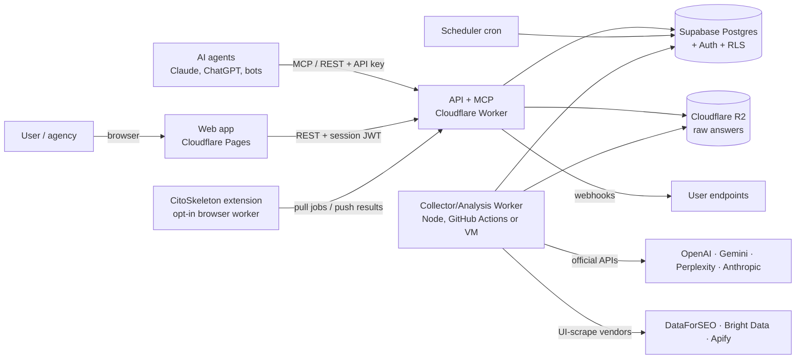

# 04 — System architecture

## 1. Principles (carried over from the extension's ARCHITECTURE.md)

1. **Raw is immutable; everything else is derived.** Store every engine payload as-is (gzip, R2);
   derive normalised records and metrics from it. Parsers and brand detection *will* change —
   reprocessing must always be possible.
2. **One glossary.** Metric definitions live in one module (`glossary.js` → `@cito/core`) shared by
   UI, API and MCP. An agent and the dashboard can never disagree on what "Visibility" means.
3. **Tracking data is isolated and locked.** A brand account's prompt-set version + collector per
   engine define a series. Changing either starts a new series rather than silently mixing data.
4. **Collectors are swappable; analysis is not.** All collection methods emit the same
   `schema.js` record, so the analysis pipeline doesn't care where an answer came from.
5. **Zero fixed cost.** Stateless edge for the API, a batch worker for heavy work, Postgres only for
   derived data, object storage for bulk.
6. **API-first.** The web app is just another API client; the MCP server is a thin adapter over
   the same service layer.

## 1a. What already exists in this repo (v0.84.0)

The plan builds on these rather than starting over:

| Already built | Where | How the cloud platform uses it |
|---|---|---|
| Accounts by emailed code (Supabase Auth, no password) | `src/lib/cloudConfig.js`, About → Account | Same Supabase project and login for the web dashboard and the extension's cloud connector |
| Server: Vercel functions, Node 20, no npm dependencies | `server/api/*.js`, `server/lib/*` | Becomes the first `apps/api`; new `/v1` endpoints are added next to `profile`, `share`, `subscribe` |
| Schema with RLS: `subscribers`, `profiles` (display names), `shared_campaigns` | `server/supabase/schema.sql` | Kept as is. The tenancy tables in 05 go in a separate `cloud` Postgres schema so `cloud.profiles` (workspaces) doesn't clash with `public.profiles` (per-user display name) |
| Campaign bundles (`.cito` file / 10-character share code) | `src/lib/campaignBundle.js` | Import path for moving an extension campaign into a cloud brand account |
| Campaign board and Excel export | `src/lib/campaignBoard.js`, `campaignXlsx.js`, `xlsxWrite.js` | Same numbers and same workbook in the cloud dashboard |
| On-device labels (Laya, built-in model) | `src/lib/laya.js`, `layaEngine.js` | Not run server-side in MVP (1.3 GB model); the label *shape* is reused so extension and cloud agree |

None of the server is deployed yet: per `server/README.md`, it is switched on by creating the Supabase
project, deploying `server/` to Vercel and filling in `cloudConfig.js`. That is also step 1 of Phase 2 in 09.

## 2. Context diagram



## 3. Components

| Component | Tech | Responsibility |
|---|---|---|
| `apps/web` | React + Vite (SPA), TanStack Query, Recharts; deployed to Cloudflare Pages | Dashboard, settings, prompt management. Talks only to the API. |
| `apps/api` | Starts as the existing `server/` Vercel functions; Zod validation; OpenAPI generated from Zod. Move to Hono on Cloudflare Workers only if Vercel Hobby's non-commercial terms or function limits bite | REST `/v1/*`, MCP `/mcp`, webhooks out, auth (Supabase JWT or API key), rate limiting. Light CPU only. |
| `apps/worker` | Node 20, TypeScript; runs as a long-ish batch process (GitHub Actions cron every 2–4 h, or `systemd` on a free VM) | Claim jobs → call collector → store raw → run analysis → write derived rows → roll up aggregates. |
| `packages/core` | The extension's pure-JS libs moved here: `schema`, `brands`, `geo`, `glossary`, `sources`, `fanout`, `deep`, `funnel-omitted`, `exportDoc`, `campaignBoard`, `campaignXlsx`, `xlsxWrite`, `campaignBundle`, `adapters/*` | Parsing, brand detection, metrics. **No platform APIs.** Consumed by worker, API (light functions only) and the extension. |
| `packages/collectors` | One module per (engine, collector) pair | Turn a job into a raw payload + `schema.js` record. See 07. |
| `packages/db` | SQL migrations (plain SQL), generated types, query helpers | Single source of DB truth. |
| `packages/sdk` | Typed TS client generated from OpenAPI | Used by web, MCP server, extension, and users' scripts. |
| Extension | Existing repo/code | Gains an opt-in cloud connector (FR-46). |

### Why not put everything in Workers?
The free plan's CPU limit (~10 ms/request) is fine for CRUD and reading aggregates, but not for
parsing 40–60 KB SSE payloads and running brand detection (`brands.js` is ~1,300 lines of regex and
heuristics). Batch work therefore runs in a plain Node process, which also keeps the worker
portable (Actions today, a VM or Fly.io tomorrow).

### Why Supabase?
Postgres (real SQL for aggregates, `FOR UPDATE SKIP LOCKED` job queue, RLS), Auth (magic link,
Google), and a free tier — one service instead of three. The 500 MB limit is handled by keeping
bulk text in R2 and rolling up old rows (see 05 §4). If it's outgrown: Supabase Pro ($25) or
self-hosted Postgres; nothing in the design is Supabase-proprietary except Auth, which sits behind
one middleware.

## 4. Run pipeline

```mermaid
sequenceDiagram
  participant C as Scheduler (cron, hourly)
  participant DB as Postgres
  participant W as Worker
  participant X as Collector (API / vendor / browser)
  participant R2 as R2 raw store
  C->>DB: for each brand account due now: create run + jobs (rotation slice, core prompts, samples)
  C->>DB: check spend cap → mark jobs 'skipped_cap' if exceeded
  W->>DB: claim N jobs per engine (SKIP LOCKED, respecting collector concurrency)
  W->>X: submit (sync call, or async task id for vendor queues)
  X-->>W: raw payload
  W->>R2: put raw/{profile}/{brand}/{yyyy-mm-dd}/{job}.json.gz
  W->>W: adapter → schema record → detectBrands → sources outcome → brandPresence
  W->>DB: insert response, mentions, sources; job=done; cost ledger
  W->>DB: on run completion: upsert daily_metrics rollup; emit run.completed webhook
```

### 4.1 Scheduling and the 7-day rotation
- Each prompt gets a stable `rotation_slot = hash(prompt_id) mod 7`. On day *d*, the run includes
  prompts with `slot = d mod 7` plus all `core` prompts. Adding prompts spreads them evenly.
- Weekly metrics use a **rolling 7-day window**, which always contains each active prompt exactly
  once per engine (per sample).
- Runs are created at 02:00 profile-local time; jobs drain over the following hours so vendor
  standard (cheap, queued) tiers can be used.

### 4.2 Job queue (Postgres, no extra service)
```sql
-- claim
update jobs set status='running', locked_by=$worker, locked_at=now(), attempts=attempts+1
where id in (
  select id from jobs
  where status in ('queued','retry') and engine=$engine and not_before <= now()
  order by priority desc, created_at
  for update skip locked limit $n)
returning *;
```
Stale locks (> 15 min) are re-queued by the scheduler. Async vendor tasks are stored with
`status='awaiting_vendor'` and `vendor_task_id`; the worker polls them (or a vendor postback hits
`/internal/vendor-callback`).

### 4.3 Concurrency and rate limits
Per collector: `max_concurrency`, `rpm`, `daily_cap` in a config table. The worker uses a token
bucket per collector. Gemini free grounding is capped at the free monthly allowance unless a
billing-enabled key is present.

### 4.4 Analysis stage (reused code)
For each raw payload:
1. `adapters/<engine>.js` (UI payloads) or `collectors/<engine>-api` mapper (API JSON) → `makeRecord()`.
2. `detectBrands(answerText, plainText, { prompt })` → mentions with rank.
3. `sources.js` → cited / fetched / mentioned outcome + `domainMatches` against brand/competitor domains.
4. `geo.brandPresence(record, trackedBrands)` → per tracked brand: present, position, cited, sourced.
5. Source category lookup (domain list table + heuristics).
6. Optional stance model (if enabled).

`analysis_version` is stored on each response; bumping it lets `reprocess` find rows to re-derive.

### 4.5 Aggregation
`daily_metrics(brand_account, engine, date, tag|null, tracked_brand)` with numerator/denominator
counts (not ratios) so any window can be summed correctly and Wilson intervals computed at read
time. The dashboard and API read only aggregates unless drilling into prompts/responses.

## 5. Auth flows

| Caller | Credential | Resolution |
|---|---|---|
| Web app | Supabase session JWT | Middleware verifies JWT → `user_id` → memberships → role per profile |
| Agent / script | `Authorization: Bearer cs_live_…` | SHA-256 lookup in `api_keys` → profile, scopes, optional brand restriction |
| MCP client | Same API key as bearer (v1); OAuth 2.1 + PKCE (v1.1) | Same as above |
| Extension worker | API key with `runs:write` + `collector:browser` scope | Can only lease `browser_worker` jobs for its profile |
| Worker | Service role key (env secret) | Bypasses RLS; never exposed |

All writes go through a service layer that checks role/scope **and** RLS is enabled on every
tenant table as defence in depth.

## 6. Repository layout (new repo `citoskeleton-cloud`)

```
citoskeleton-cloud/
├─ apps/
│  ├─ web/            React SPA
│  ├─ api/            Hono Worker: /v1 REST, /mcp, /internal
│  └─ worker/         Node batch worker (collect, analyse, rollup, reprocess)
├─ packages/
│  ├─ core/           ← moved from extension src/lib + src/adapters + src/schema.js
│  ├─ collectors/     api + vendor + browser-lease collectors per engine
│  ├─ db/             migrations/*.sql, seed, types
│  └─ sdk/            generated TS client
├─ docs/              ← this planning pack
├─ .github/workflows/ ci.yml, worker-cron.yml, deploy.yml
└─ package.json       pnpm workspaces, turbo
```

The extension keeps its own repo and consumes `packages/core` (published to npm or vendored by a
sync script) so fixes to brand detection reach both products. See 09 Phase 0.

## 7. Key technology choices

| Choice | Picked | Alternatives considered | Why |
|---|---|---|---|
| Language | TypeScript (JS core as-is first, typed gradually) | Python | Reuses ~29k lines of tested JS |
| API runtime | Vercel functions (already in `server/`) to start; Cloudflare Workers + Hono as the fallback | Supabase Edge Functions | Reuse what exists. Vercel Hobby is non-commercial, so move to Workers (or Vercel Pro) before charging anyone |
| DB | Supabase Postgres | Neon, Cloudflare D1 | Postgres + Auth + RLS in one free tier |
| Queue | Postgres `SKIP LOCKED` | Cloudflare Queues, Redis | No extra service or cost |
| Worker host | GitHub Actions cron → free VM later | Fly.io, Render, Railway | $0; portable Docker image |
| Object store | Cloudflare R2 | Supabase Storage, S3 | 10 GB free, no egress fees |
| MCP | `@modelcontextprotocol/sdk` Streamable HTTP inside the API Worker | Separate server | One deployment, same auth |
| Charts | Recharts | ECharts | Small, React-native |

## 8. Failure modes and how the design handles them

| Failure | Handling |
|---|---|
| Engine payload format changes (UI collectors) | Raw stored; adapter drift telemetry (existing "fallback fired" flag); fix adapter → `reprocess` |
| Vendor outage / price change | Collector registry per engine; switch collector = new series, flagged on charts |
| Worker crash mid-run | Lock timeout re-queues; idempotent writes keyed on `job_id` |
| Spend runaway | Spend cap checked at enqueue and every 100 jobs; cost ledger per job |
| Free-tier DB fills | Rollup + retention job; size alarm at 80% |
| Supabase pause (7 days idle) | Daily scheduler writes keep it active; health check alarm |
| Bad prompt edit mid-series | Prompt-set versioning; mixed-version banner |
