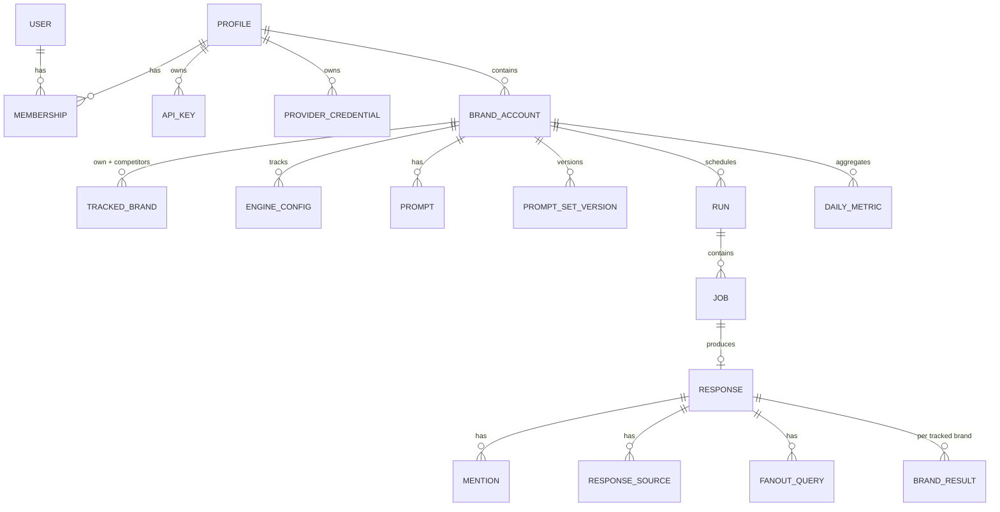

# 05 — Data model

Postgres 15+ (Supabase). All tenant tables carry `profile_id` and have RLS enabled. IDs are
`uuid` (v7 where available, for index locality). Times are `timestamptz`.

## 1. Entity overview



## 2. DDL (MVP)

```sql
-- ---------- tenancy ----------
create table profiles (
  id uuid primary key default gen_random_uuid(),
  name text not null,
  timezone text not null default 'Asia/Kolkata',
  default_country text not null default 'IN',
  default_language text not null default 'en',
  monthly_spend_cap_usd numeric(10,2) not null default 50,
  retention_days int not null default 180,
  created_at timestamptz not null default now()
);

create table memberships (
  profile_id uuid references profiles on delete cascade,
  user_id uuid references auth.users on delete cascade,
  role text not null check (role in ('owner','admin','editor','viewer')),
  primary key (profile_id, user_id)
);

create table api_keys (
  id uuid primary key default gen_random_uuid(),
  profile_id uuid not null references profiles on delete cascade,
  name text not null,
  prefix text not null,               -- first 8 chars shown in UI, e.g. cs_live_AB12
  key_hash bytea not null unique,     -- sha256(full key)
  scopes text[] not null,             -- read, prompts:write, brands:write, runs:write, admin, collector:browser
  brand_account_ids uuid[],           -- null = all brands in profile
  expires_at timestamptz,
  last_used_at timestamptz,
  revoked_at timestamptz,
  created_by uuid references auth.users,
  created_at timestamptz not null default now()
);

create table provider_credentials (       -- BYOK
  id uuid primary key default gen_random_uuid(),
  profile_id uuid not null references profiles on delete cascade,
  provider text not null,             -- openai, gemini, perplexity, anthropic, dataforseo, brightdata, apify
  ciphertext bytea not null,          -- AES-256-GCM, key from env KMS secret; see 08
  nonce bytea not null,
  last4 text not null,
  created_at timestamptz not null default now(),
  unique (profile_id, provider)
);

-- ---------- brand accounts ----------
create table brand_accounts (
  id uuid primary key default gen_random_uuid(),
  profile_id uuid not null references profiles on delete cascade,
  name text not null,
  country text not null,
  language text not null,
  schedule text not null default 'rotation_7d'
    check (schedule in ('daily','rotation_7d','weekly','manual')),
  weekly_day smallint,                -- 0-6 when schedule='weekly'
  samples_per_run smallint not null default 1 check (samples_per_run between 1 and 5),
  spend_cap_usd numeric(10,2),
  current_prompt_set_version int not null default 1,
  archived_at timestamptz,
  created_at timestamptz not null default now()
);

create table tracked_brands (
  id uuid primary key default gen_random_uuid(),
  profile_id uuid not null,
  brand_account_id uuid not null references brand_accounts on delete cascade,
  kind text not null check (kind in ('own','competitor','excluded')),
  name text not null,
  aliases text[] not null default '{}',
  domains text[] not null default '{}',
  origin text not null default 'manual' check (origin in ('manual','suggested')),
  created_at timestamptz not null default now()
);

create table engine_configs (
  brand_account_id uuid references brand_accounts on delete cascade,
  profile_id uuid not null,
  engine text not null,               -- chatgpt, gemini, perplexity, google_ai_mode, google_aio, claude, grok, copilot
  collector text not null,            -- e.g. 'dataforseo_ui', 'gemini_api_grounding', 'sonar_api', 'browser_worker'
  series_id uuid not null default gen_random_uuid(),  -- new series when collector changes
  enabled boolean not null default true,
  primary key (brand_account_id, engine)
);

-- ---------- prompts ----------
create table prompts (
  id uuid primary key default gen_random_uuid(),
  profile_id uuid not null,
  brand_account_id uuid not null references brand_accounts on delete cascade,
  text text not null,
  text_norm text generated always as (lower(regexp_replace(text, '\s+', ' ', 'g'))) stored,
  topic text,
  tags text[] not null default '{}',
  intent text check (intent in ('informational','commercial','transactional','local','navigational')),
  is_core boolean not null default false,
  rotation_slot smallint not null,    -- hash(id) % 7
  active_from_version int not null,
  active_to_version int,              -- null = still active
  created_at timestamptz not null default now(),
  unique (brand_account_id, text_norm, active_from_version)
);
create index on prompts (brand_account_id, rotation_slot) where active_to_version is null;
create index on prompts using gin (tags);

create table prompt_set_versions (
  brand_account_id uuid references brand_accounts on delete cascade,
  version int not null,
  note text,
  created_at timestamptz not null default now(),
  primary key (brand_account_id, version)
);

-- ---------- execution ----------
create table runs (
  id uuid primary key default gen_random_uuid(),
  profile_id uuid not null,
  brand_account_id uuid not null references brand_accounts on delete cascade,
  run_date date not null,
  trigger text not null check (trigger in ('schedule','manual','api')),
  prompt_set_version int not null,
  status text not null default 'queued',
  est_cost_usd numeric(10,4), actual_cost_usd numeric(10,4) default 0,
  created_at timestamptz not null default now(),
  finished_at timestamptz
);

create table jobs (
  id uuid primary key default gen_random_uuid(),
  profile_id uuid not null,
  run_id uuid not null references runs on delete cascade,
  prompt_id uuid not null references prompts,
  engine text not null,
  collector text not null,
  series_id uuid not null,
  sample_no smallint not null default 1,
  status text not null default 'queued'
    check (status in ('queued','running','awaiting_vendor','retry','done','failed','skipped_cap')),
  priority smallint not null default 0,
  attempts smallint not null default 0,
  not_before timestamptz not null default now(),
  locked_by text, locked_at timestamptz,
  vendor_task_id text,
  error text,
  cost_usd numeric(10,5),
  created_at timestamptz not null default now(),
  unique (run_id, prompt_id, engine, sample_no)
);
create index jobs_claim on jobs (engine, status, not_before) where status in ('queued','retry');

-- ---------- results ----------
create table responses (
  id uuid primary key default gen_random_uuid(),
  profile_id uuid not null,
  job_id uuid not null unique references jobs on delete cascade,
  brand_account_id uuid not null,
  prompt_id uuid not null,
  engine text not null,
  series_id uuid not null,
  model text,
  captured_at timestamptz not null,
  run_date date not null,
  searched boolean,
  answer_excerpt text,                -- first ~500 chars; full text in R2
  raw_key text not null,              -- R2 object key
  analysis_version int not null,
  schema_version int not null,
  platform_specific jsonb
);
create index on responses (brand_account_id, engine, run_date);

create table mentions (              -- every brand detected in the answer
  response_id uuid references responses on delete cascade,
  profile_id uuid not null,
  name text not null, name_norm text not null,
  rank smallint not null,
  tracked_brand_id uuid,              -- null if not tracked
  primary key (response_id, name_norm)
);

create table response_sources (
  response_id uuid references responses on delete cascade,
  profile_id uuid not null,
  url text not null, domain text not null,
  outcome text not null check (outcome in ('cited','fetched','mentioned')),
  position smallint,
  category text,                      -- editorial, ugc, reference, own, competitor, retailer, other
  tracked_brand_id uuid,
  primary key (response_id, url)
);
create index on response_sources (profile_id, domain);

create table fanout_queries (
  response_id uuid references responses on delete cascade,
  profile_id uuid not null,
  kind text not null,                 -- search, shopping, image
  query text not null,
  round smallint
);

create table brand_results (          -- one row per response x tracked brand: the metric atoms
  response_id uuid references responses on delete cascade,
  profile_id uuid not null,
  tracked_brand_id uuid not null,
  present boolean not null,
  position smallint,
  cited boolean not null,
  sourced boolean not null,
  mention_count smallint not null default 0,
  primary key (response_id, tracked_brand_id)
);

-- ---------- aggregates (kept forever) ----------
create table daily_metrics (
  profile_id uuid not null,
  brand_account_id uuid not null,
  series_id uuid not null,
  engine text not null,
  run_date date not null,
  tag text not null default '*',      -- '*' = all prompts
  tracked_brand_id uuid not null,
  responses int not null,             -- denominator
  present int not null,
  cited int not null,
  sourced int not null,
  mentions int not null,
  all_tracked_mentions int not null,  -- SOV denominator
  position_sum int not null,
  position_n int not null,
  stable int, stable_n int,
  primary key (brand_account_id, series_id, engine, run_date, tag, tracked_brand_id)
);

-- ---------- ops ----------
create table cost_ledger (
  id bigserial primary key,
  profile_id uuid not null,
  job_id uuid, collector text not null,
  usd numeric(10,5) not null,
  at timestamptz not null default now()
);

create table audit_log (
  id bigserial primary key,
  profile_id uuid not null,
  actor_user uuid, actor_key uuid,
  action text not null, target text, detail jsonb,
  at timestamptz not null default now()
);

create table webhooks (
  id uuid primary key default gen_random_uuid(),
  profile_id uuid not null references profiles on delete cascade,
  url text not null, secret_hash bytea not null,
  events text[] not null, active boolean not null default true
);
```

## 3. Row-level security pattern

```sql
alter table brand_accounts enable row level security;
create policy tenant_read on brand_accounts for select
  using (profile_id in (select profile_id from memberships where user_id = auth.uid()));
create policy tenant_write on brand_accounts for all
  using (profile_id in (select profile_id from memberships
                        where user_id = auth.uid() and role in ('owner','admin','editor')));
```
Applied to every table with `profile_id`. API-key requests run with the service role but the
API layer injects `profile_id` and brand filters from the key on every query (enforced in one
repository helper and covered by tests).

## 4. Storage budget (Supabase free = 500 MB)

| Table | Rows per response | Approx bytes per response (incl. index) |
|---|---|---|
| responses | 1 | ~1,200 |
| mentions | ~8 | ~900 |
| response_sources | ~10 | ~2,000 |
| fanout_queries | ~4 | ~400 |
| brand_results | ~6 | ~400 |
| **Total** | | **≈ 5 KB** |

1,000 prompts × 4 engines, 7-day rotation → 17,320 responses/month → **≈ 85 MB/month**.
`daily_metrics` is tiny (~100 bytes × engines × tags × brands per day).

**Retention job (nightly):** delete `responses` (cascade) older than `profiles.retention_days`
(default 180) — aggregates and R2 raw remain, so data can be restored by reprocessing. Steady state
for one brand ≈ 510 MB at 180 days → set default retention to **120 days on the free tier**
(~340 MB), 365+ days on Pro.

## 5. R2 object layout

```
raw/{profile_id}/{brand_account_id}/{yyyy}/{mm}/{dd}/{engine}/{job_id}.json.gz
   { collector, request, response (verbatim), captured_at, collector_version }
exports/{profile_id}/{export_id}.xlsx      (expire after 7 days)
```
